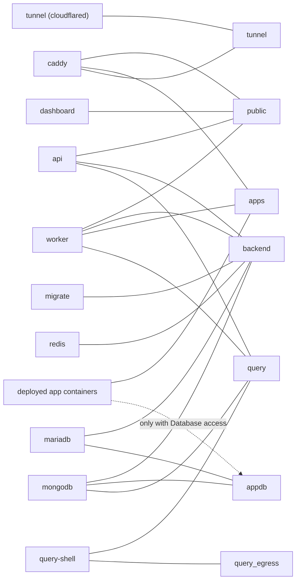
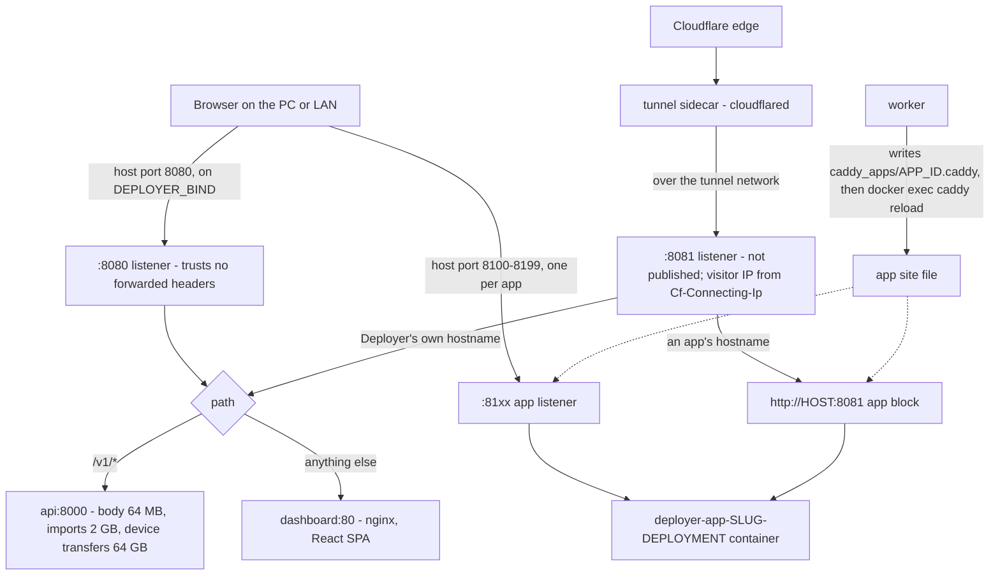
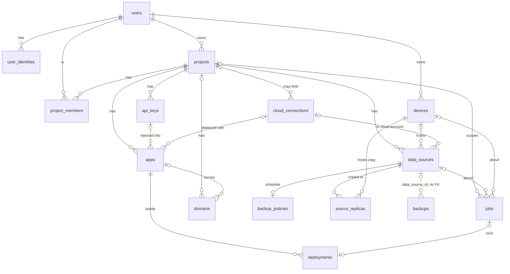
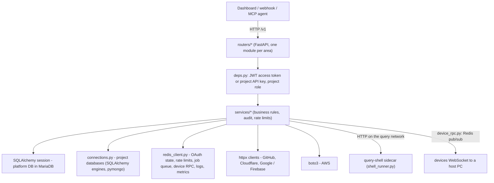
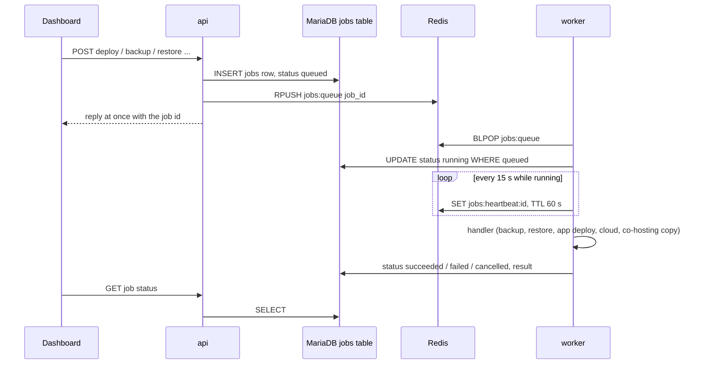

# Deployer — Architecture

Deployer is an open-source, self-hosted backend + deployment platform (think Supabase + Vercel)
designed to run on an ordinary — even old — Windows PC. Every installation is fully independent:
it ships with **no** API keys, OAuth apps or accounts belonging to the Deployer authors. The person
who installs it creates their own (optional) Google/GitHub OAuth apps through the setup wizard, and
every password/secret is generated locally at install time.

## Guiding rules

1. **Self-contained.** Nothing phones home. No author-owned credentials anywhere in code or images.
2. **Free by default.** The installer prefers the open-source Docker Engine inside a dedicated WSL2
   distro. Docker Desktop is offered as an alternative; if a user needs a paid Docker subscription
   they sign in to Docker themselves.
3. **One control plane.** Dashboard, GitHub webhooks and AI agents (MCP) all call the same HTTP API,
   which enforces the same auth, roles and audit logging. Nobody touches MariaDB/MongoDB/Redis directly.
4. **Portable.** A single encrypted JSON export (settings + users + projects + **data**) restores a
   whole installation, or selected projects, on another device.

## Components

```text
Browser / phone / AI agent
        │ HTTP(S)
        ▼
  caddy  (host port DEPLOYER_HTTP_PORT, default 8080; internal :8081 for the tunnel;
   │      host ports 8100-8199, one per deployed app, from `caddy_apps/<app_id>.caddy`)
   ├── /v1/*  → api        (FastAPI, Python 3.12)
   ├── /*     → dashboard  (React + Vite SPA served by nginx)
   └── :81xx  → deployer-app-<slug>-<dep>  (app containers on the `apps` network, DEPLOYMENTS.md)
                 │
   backend network (internal: true)
   ├── mariadb:11   platform metadata DB `deployer` + managed SQL databases `p_<ref>` (binlog on)
   ├── mongo:8.0    managed NoSQL databases `p_<ref>` (single-node replica set for the oplog)
   ├── redis:7      OAuth state, rate limits, job queue, device RPC routing, app runtime logs, metrics
   ├── worker       jobs + scheduler: backups, log archiving, pruning, verification; app builds and
                    containers (root + /var/run/docker.sock, writes the Caddy app files); on a host
                    device also the outbound connection to the main Deployer
   └── migrate      one-shot `alembic upgrade head` on every `up`; the api starts only after it exits 0,
                    so a slow migration never runs inside the api healthcheck window

  query-shell (query network with api, worker, mongodb) — runs query console mongosh code with no
              secrets, volumes or Docker socket (QUERY_CONSOLE.md, SECURITY.md "Query console")
  appdb (internal: mariadb, mongodb) — joined by app containers with database access (DEPLOYMENTS.md)
  tunnel (optional, tunnel network with caddy only) — cloudflared connector for Cloudflare remote
         access; Caddy's :8081 trusts Cf-Connecting-Ip only from this network (SECURITY.md)
```

| Path | Contents |
|---|---|
| `api/` | FastAPI control plane (`app/`), Alembic migrations, tests, Dockerfile |
| `dashboard/` | React + TypeScript + Vite SPA, Dockerfile (nginx) |
| `deploy/` | `docker-compose.yml`, `docker-compose.dev.yml` (API hot reload for checkouts), `Caddyfile`, `.env.example`, `mongodb/` (replica-set entrypoint), `tunnel/` (cloudflared sidecar image) |
| `installer/` | `install.ps1` (Windows bootstrap), `deployer.ps1` (manage CLI), `install.sh` + `deployer.sh` (Linux bootstrap and manage CLI, docs/SETUP.md), WSL engine scripts (`setup-engine.sh --host` also installs Docker on Debian/Ubuntu servers), `windows/` (`DeployerSetup.exe`: setup wizard + Deployer Control, C# WinForms on .NET Framework 4.8) |
| `docs/` | This file and the other specs: see the [documentation index](../README.md#documentation) |

## Diagrams

### Compose services and the Docker networks they join



From `deploy/docker-compose.yml` (`services.*.networks` and the `networks:` block).

A Docker network is a private wire: two containers can only talk if they share one. `backend`, `appdb` and `query` are marked `internal`, so nothing on them can reach the internet by itself; `public`, `apps`, `tunnel` and `query_egress` can. The databases sit on `backend` where only the API, worker and migrate job see them; a deployed app gets `apps` (Caddy and the worker) and, only if an admin ticks *Database access*, `appdb`, which has the databases but never the API or Redis. The query console's shells live on `query` with their own way out (`query_egress`) so untrusted code never shares a wire with Deployer's secrets.

### The request path through Caddy



From `deploy/Caddyfile`, the `caddy` service in `deploy/docker-compose.yml`, `services/deployments.py` (`container_name`, `render_caddyfile`, `route_app`) and `services/app_runner.py` (`caddy_reload`).

Caddy is the one program that listens for web requests. Requests that start with `/v1` go to the API; everything else is the dashboard's web pages. The same rule runs on two doors: `:8080`, which is opened on the PC, and `:8081`, which is not opened on the PC and is the Cloudflare tunnel's way in; a visitor IP header is believed only on `:8081` and only from the tunnel's network. Deployed apps get their own doors in Caddy too: a port in 8100-8199 on the PC and, when they have a public hostname, a block on `:8081` that catches that hostname before the dashboard does. The worker writes both into one file per app and asks Caddy to reload.

### Platform tables and their key relations



From `api/app/models.py` (`ForeignKey(...)` columns; `backups.data_source_id` is a plain column so backups outlive deleted sources).

Every line is a column in one table that holds the id of a row in another, which is how the database keeps "this deployment belongs to that app" straight. `||` means exactly one, `o{` means zero or many: a project has many data sources, an app has many deployments, a device can hold copies of many databases. The dotted line is the one place a link is kept on purpose without a database rule, so a backup can still be listed after its database is gone. Smaller tables (invites, refresh tokens, audit log, query log, saved queries, sync conflicts, GitHub connections, app replicas, device enrollments) hang off the same ids and are listed in the table below.

### Inside the API: routers, services, drivers



From `api/app/main.py` (router registration), `deps.py`, and the imports of `services/connections.py`, `cloud_aws.py`, `cloud_gcp.py`, `cloudflare.py`, `github.py`, `device_rpc.py`.

A request lands in a router, which only parses it and checks who is asking; the real decisions sit in a service module so the dashboard, GitHub webhooks and AI agents all get the same rules. Services then talk to the outside world through a few drivers: the platform database, the project databases, Redis for short-lived state, and HTTP clients for the owner's own accounts. The drivers below the service layer know nothing about users or roles.

### Background jobs: the worker and the Redis queue



From `api/app/services/jobs.py` (`dispatch`, `run_job`, heartbeat and cancel keys) and `api/app/worker.py` (`runner_loop`, scheduler leader election).

Slow work (a backup, a build, a copy to another PC) is not done while the browser waits; the API writes a job row, nudges the worker through a Redis list, and answers at once. The job row is the truth and Redis is only the doorbell: if a nudge is lost, the worker's scheduler re-sends jobs still marked `queued` after a minute, and a job whose heartbeat stops (worker crash) is marked failed. With more than one worker, a Redis key with a 30-second lease elects one leader to run the scheduler, so timed work (snapshots, pruning, alerts) runs once. Exports and imports are the exception and run inside the API process so the passphrase never leaves it.

## Data model (platform DB, MariaDB `deployer`)

All primary keys are UUID strings (`CHAR(36)`) so exports can be imported without ID collisions.
Source of truth: `api/app/models.py`.

| Table | Purpose |
|---|---|
| `instance_settings` | key/value settings (public URL, OAuth client IDs, encrypted client secrets, signup policy) |
| `users` | accounts; `password_hash` nullable (OAuth-only users); first user is `is_instance_owner` |
| `user_identities` | linked Google/GitHub identities (`provider`, `provider_user_id`) |
| `refresh_tokens` | hashed rotating refresh tokens, grouped by `family_id` for reuse detection |
| `cli_tokens`, `cli_logins` | hashed `deployer login` tokens per user, and the pending code approvals that issue them ([CLI.md](CLI.md)) |
| `projects` | a project groups data sources, members, API keys and apps (deployments) |
| `project_members` | `owner` / `admin` / `developer` / `viewer` |
| `project_invites` | hashed single-use invite tokens (optional email lock) |
| `data_sources` | SQL and/or NoSQL databases attached to a project — `managed` (on this host) or `external` (e.g. Atlas, remote MySQL/Postgres, or AWS RDS / DynamoDB tables / a Firebase project's Firestore or Realtime Database, or a Firebase project's Firestore database in the user's account with `cloud_connection_id` / `cloud_state`); connection config encrypted |
| `schema_links` | user-declared relationships, incl. **cross-database** links (SQL column ↔ Mongo field) |
| `api_keys` | hashed per-project keys (`anon` / `service`) |
| `audit_logs` | security-relevant events (owner: `GET /instance/audit`; pruned after 90 days) |
| `apps`, `deployments` | push-to-deploy: a Git-backed app per project (encrypted env / repo token / webhook secret, a Caddy port for life) and its builds; `domains.app_id` links an app hostname ([DEPLOYMENTS.md](DEPLOYMENTS.md)) |
| `cloud_connections` | the owner's AWS / Firebase credentials (encrypted), instance-wide or per project; `apps.target` / `cloud_connection_id` / `cloud_state` put an app on a cloud target, `deployments.target_url`, `domains.dns_records` for cloud custom domains; `data_sources.cloud_connection_id` / `cloud_state` for databases in the user's AWS account ([CLOUD.md](CLOUD.md)) |
| `devices`, `device_enrollments`, `device_project_grants` | other PCs that host databases / apps / backup copies, their enrollment codes and which projects they may serve ([DEVICES.md](DEVICES.md)) |
| `jobs` | background work rows (type, status, progress, params, result); the worker claims them from the Redis queue |
| `backup_policies`, `backups`, `backup_log_segments`, `backup_copies` | per-source schedule, snapshot artifacts, binlog / oplog segments for point-in-time recovery, where each artifact's bytes live ([BACKUPS.md](BACKUPS.md)) |
| `domains` | Cloudflare tunnel hostnames and cloud custom domains for the dashboard or an app ([REMOTE_ACCESS.md](REMOTE_ACCESS.md)) |
| `query_runs`, `saved_queries`, `saved_query_versions` | the query log (every run with its text; audit logs keep counts only) and notebooks with their history ([QUERY_EDITOR.md](QUERY_EDITOR.md)) |
| `source_replicas`, `sync_conflicts`, `sync_versions` | live database copies on members' devices, their sync positions, conflicts and per-key history ([COHOSTING.md](COHOSTING.md)) |
| `app_replicas`, `github_connections` | co-hosted app copies on devices; a user's GitHub OAuth token for repository access |

## Security model

- Passwords: argon2id. Access tokens: HS256 JWT, 15 min, sent as `Authorization: Bearer`.
- Refresh tokens: 256-bit random, stored as SHA-256 hash, rotated on every use, HttpOnly cookie
  `deployer_rt` (`Path=/v1/auth`, `SameSite=Lax`, `Secure` when the request came over https, so
  LAN http sessions keep working after remote access). Reusing a rotated token revokes the whole family.
- Secrets at rest (OAuth client secrets, external DB passwords): AES-256-GCM with `MASTER_KEY`
  from `.env` (`app/crypto.py`).
- OAuth: authorization-code flow with `state` + PKCE, state kept in Redis for 10 minutes.
- **Account linking is never automatic.** Signing in with a provider whose email matches an existing
  account is refused with `account_exists_link_required`; the user signs in the usual way and links
  from *Settings → Account*. An identity can belong to only one user. A user cannot remove their last
  login method.
- Login rate limit: 10 attempts / 15 min per IP+email, 50 failed attempts / hour per email from any
  IP (cleared by a successful sign-in or `deployer reset-password`), and 30 password logins + signups
  / 15 min per IP (Redis; on `:8080` every LAN/localhost client has the same gateway IP, so that cap
  is LAN-wide - SECURITY.md); at most two argon2 hashes run at once so floods queue instead of exhausting memory. Project API keys: 600 requests/min per
  key by default (`api_key_rate_limit`), 429 with `Retry-After` ([MONITORING.md](MONITORING.md)).
- Managed databases get their own DB user restricted to that database only, capped at
  `MANAGED_DB_MAX_USER_CONNECTIONS` (default 20) connections so one app cannot use up the connections
  the platform database shares with it; the worker applies the cap to existing users when it starts.

## Export / import format

A single `.json` file:

```json
{
  "format": "deployer-export",
  "version": 1,
  "scope": "instance | projects",
  "created_at": "2026-09-16T10:00:00Z",
  "app_version": "0.1.0",
  "encryption": { "cipher": "AES-256-GCM", "kdf": "scrypt", "n": 32768, "r": 8, "p": 1,
                  "salt": "<b64>", "nonce": "<b64>" },
  "payload": "<b64 of AES-GCM(gzip(plaintext JSON))>"
}
```

The payload always contains settings/users/projects/members/pending invites/api-key hashes/data
sources (with connection secrets)/schema links, **plus the full contents of every managed database**:
SQL tables as DDL + rows, Mongo collections as options + indexes + documents (canonical Extended
JSON). External databases are reconnected, not copied. A passphrase (min 12 chars) is required
because the file contains password hashes and secrets.

Not carried: MariaDB views, triggers, stored routines and events (counted per database as
`"skipped"` and reported as `warnings` in the export's audit entry and the import summary; recreate
them from a SQL dump), backup files and versions / point-in-time history, deployments, query runs and
audit logs. The dashboard's Export & import page lists these exclusions.

Size: export streams to disk, but import unpacks and parses the whole payload in memory, so the
importing API takes at most a sixth of its free memory (the less of the machine's and the container's
`API_MEM_LIMIT`, 768m by default, so roughly 80 MB), capped at 1 GiB, for both the uploaded file and the
unpacked payload (`413 file_too_large` with the current limit in `details.limit_bytes`). Raise
`API_MEM_LIMIT` in `deploy/.env` for bigger imports, or move bigger databases with a SQL dump
(`mariadb-dump` / `mongodump`). Moves, co-host copies and restores on a host device read a single
source's `data` entry as a stream instead (`transfer.restore_file`: one batch of rows / documents in
memory at a time), so they have no such limit.

Time (A-044): the dashboard runs exports and imports as background jobs (`transfer.export` /
`transfer.import`, API.md "Export / import jobs"), so the ~100 s limit of a request through remote
access (Cloudflare Tunnel) no longer applies to them. The request only starts the job (an import first
uploads, checks and decrypts the file, so a wrong passphrase answers at once); progress shows under
*Settings → Export & import → Recent exports & imports* and, for a one-project export, in that
project's Activity drawer; the finished export is downloaded from `GET /transfers/{job_id}/download`.
These jobs run in a thread of the API process, not the worker: the passphrase and the decrypted import
payload stay in that process's memory (never in the `jobs` row or Redis), imports keep the API's memory
budget above, and the file is served by the container that wrote it. An API restart fails a running
one ("worker stopped"); start it again. Finished export files are kept 24 hours, then deleted. The
synchronous `POST /instance/export`, `/projects/export`, `/projects/import` and the setup wizard's
`/setup/import` (a fresh install has no remote access yet) still work inside the request; through a
tunnel use the job forms.

- `scope: instance` — made by the instance owner; imported by the setup wizard on a fresh install
  ("Restore from export") and restores everything, including all users.
- `scope: projects` — made by any user for projects they own; imported by any user on another
  installation, which recreates those projects (and their data) owned by the importer.

After restoring on a new device the wizard shows the new OAuth callback URLs to paste into the
user's Google/GitHub OAuth apps if the public URL changed.

## Roadmap

See the [Roadmap in the README](../README.md#roadmap) - it is the only copy.
