# How the main code paths work

This page follows eight things Deployer does, step by step, as the code does them. Each section has
one or more diagrams (GitHub draws them from the Mermaid text) and a line naming the files they were
drawn from, so you can check a diagram against the code or update it after a change.

A few words used throughout:

- **API**: the FastAPI server in `api/app` (the dashboard, GitHub webhooks and AI agents all call it).
- **Worker**: the same code started as `python -m app.worker`. It runs background **jobs** (rows in the
  `jobs` table; Redis only carries "wake up, job X is ready") and a **scheduler** that one worker at a
  time leads, every 15 seconds.
- **Platform database**: Deployer's own MariaDB database (users, projects, jobs, ...). Your projects'
  databases are separate.
- **Caddy**: the web server in front of everything; it forwards requests to the API, the dashboard and
  your deployed apps.

For the bigger picture start with [ARCHITECTURE.md](ARCHITECTURE.md); for every endpoint see
[API.md](API.md).

## 1. Signing in

### With an email and password

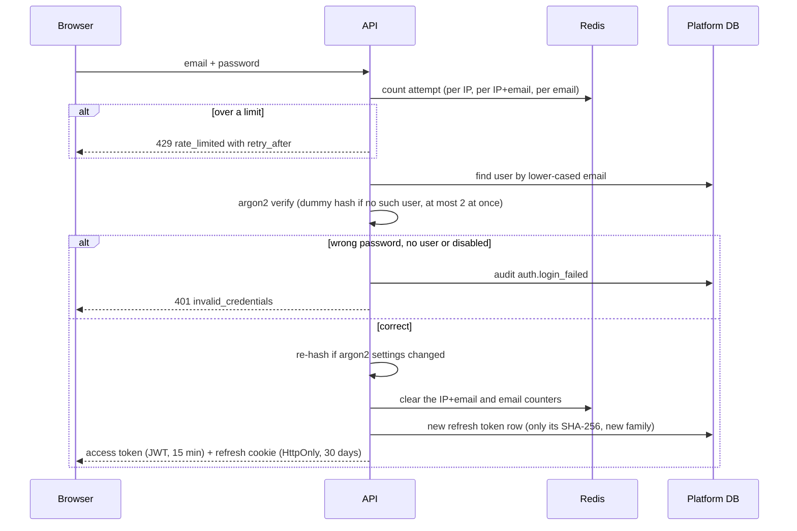

From `api/app/routers/auth.py`, `services/rate_limit.py`, `services/passwords.py` and `services/tokens.py`.

Every attempt is counted in Redis in three buckets: one per network address (30 per 15 minutes), one
per address and email (10 per 15 minutes) and one per email from anywhere (50 per hour). The password
is checked with argon2, which is slow on purpose; an unknown email is checked against a dummy hash so
both answers take the same time. A success gives the browser a short-lived access token to send with
each request and a long-lived refresh cookie that JavaScript cannot read. If Redis is down the limits
are skipped rather than locking everyone out.

### Keeping the session alive (refresh rotation)

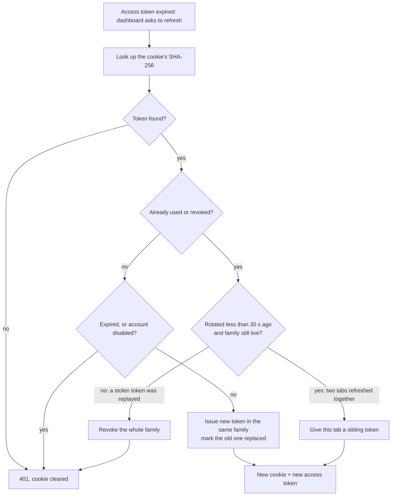

From `api/app/services/tokens.py` (`rotate_refresh_token`) and `dashboard/src/api/client.ts`.

Each refresh token works once: using it hands out a new one and retires the old. If a retired token
shows up again, someone may have copied it, so every token of that sign-in (the "family") is revoked
and the person must sign in again. The one exception is two browser tabs refreshing in the same
moment, which a 30-second grace window allows. Signing out revokes the family; changing your password
revokes every other sign-in.

### With Google or GitHub

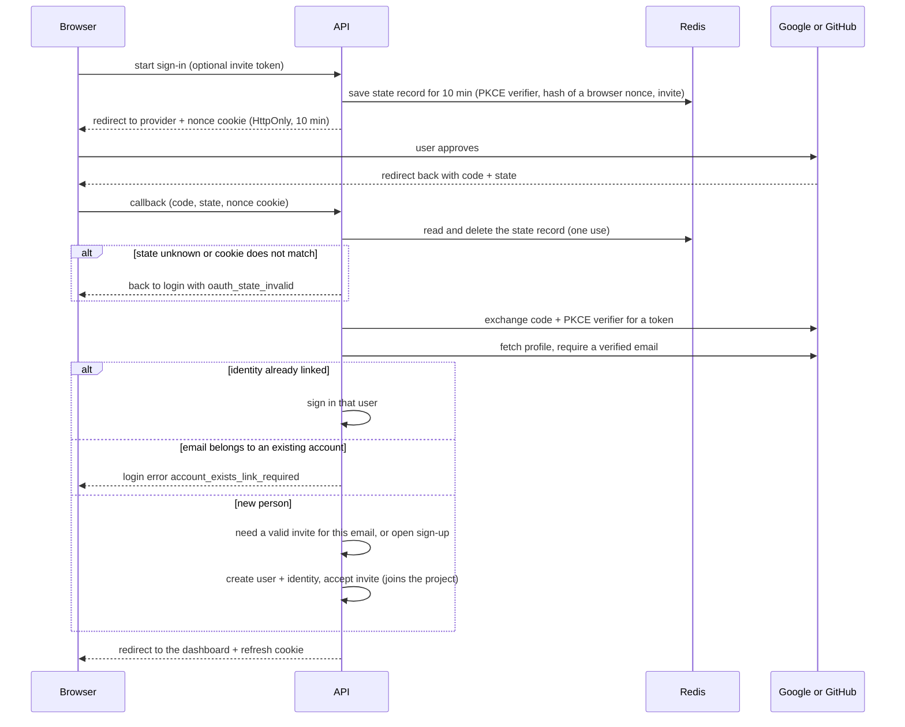

From `api/app/routers/auth.py` (`oauth_start`, `oauth_callback`) and `api/app/services/oauth.py`.

The state record proves the callback answers a sign-in this Deployer started, PKCE proves the code was
not intercepted, and the nonce cookie ties the flow to the browser that started it, so a link crafted
by someone else cannot sign you into their account. Deployer never merges accounts by itself: if the
email already has a password account, you must sign in and link Google or GitHub from your settings.
An invite only works for the email it was sent to.

## 2. A data API request with an API key

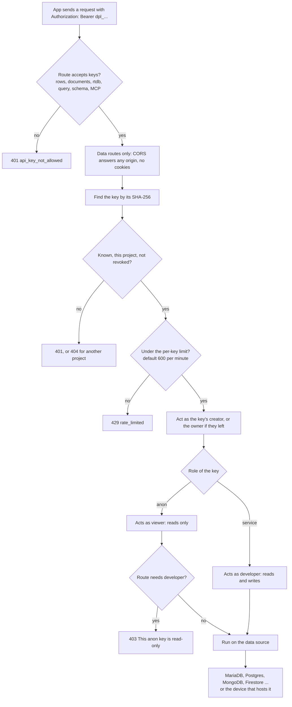

From `api/app/main.py` (`KEY_ROUTES`, `KeyRoutesCORS`), `api/app/deps.py` (`require_role`,
`load_api_key_access`, `check_api_key_rate`), `api/app/routers/data.py` and `api/app/routers/mcp.py`.

Project API keys start with `dpl_`; only a hash is stored, so the key itself is never kept on the PC.
An anon key (safe to put in a website) can only read rows and documents; a service key can also
write. Browsers may call these routes from any website, but never with cookies, so a key cannot be
used to ride on someone's dashboard session. Each key has its own request limit per minute, and keys
of a disabled owner stop working. Anon keys cannot use the query console at all (section 3).

## 3. Running a query in the console or notebook

### SQL

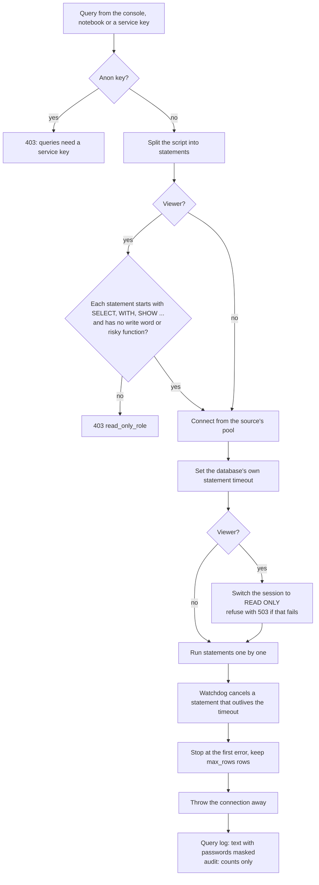

From `api/app/routers/query.py` (`run_query`), `api/app/services/query_console.py` (`run_sql`,
`sql_read_only_refusal`, `_Watchdog`) and `api/app/services/query_log.py` (`record_run`, `redact`).

A viewer's SQL is checked twice: first by reading the words (every statement must start like a read
and contain no writing keyword), then by the database itself, which is told to refuse writes for this
session. A timer cancels any statement that runs longer than the chosen timeout, even if the
database's own timeout did not apply. Afterwards the connection is discarded so settings changed by
the script cannot leak into the next request. Every run, including refusals, lands in the query log
with passwords in the text replaced by `***`.

### MongoDB

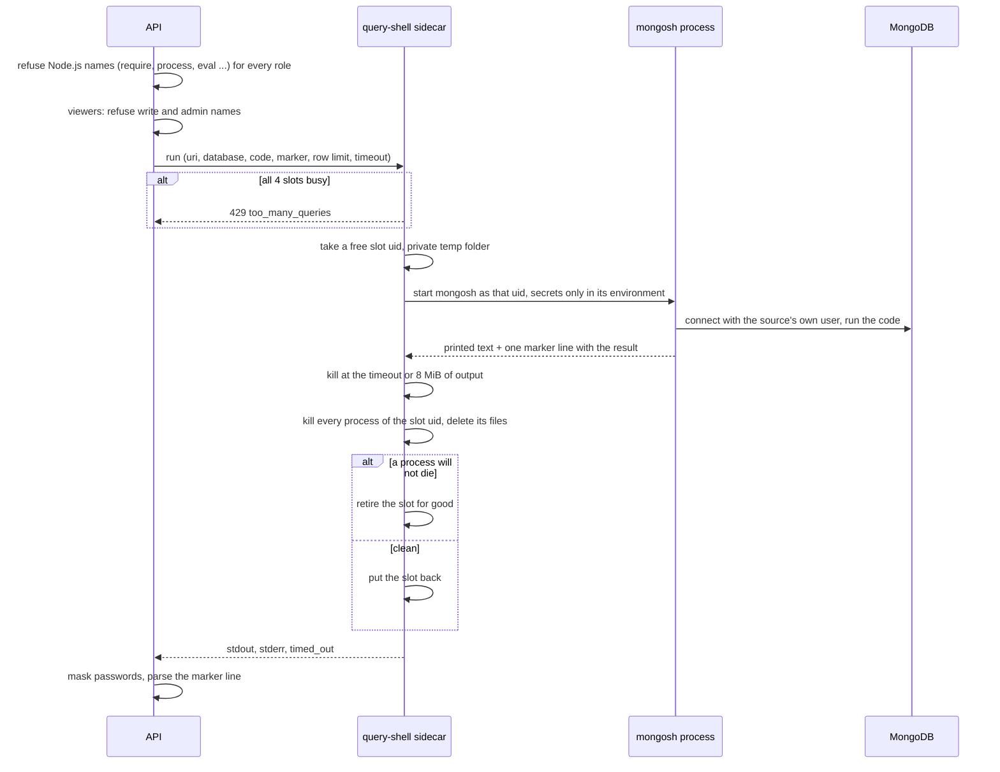

From `api/app/services/query_console.py` (`run_mongosh`, `_call_shell`) and `api/app/shell_runner.py`
(`Runner.run`, `_clean_up_slot`).

MongoDB shell code is real JavaScript, so it never runs inside the API, which holds Deployer's secrets.
It runs in a separate small container with no secrets, under one of four throw-away user ids, so one
query cannot spy on the next. After each run everything that user id started is killed and its files
removed; if that fails the slot is never used again. The word checks are a first filter only: for
viewers the real limit is the MongoDB user the source connects with.

## 4. Push-to-deploy

### From a push to a queued job

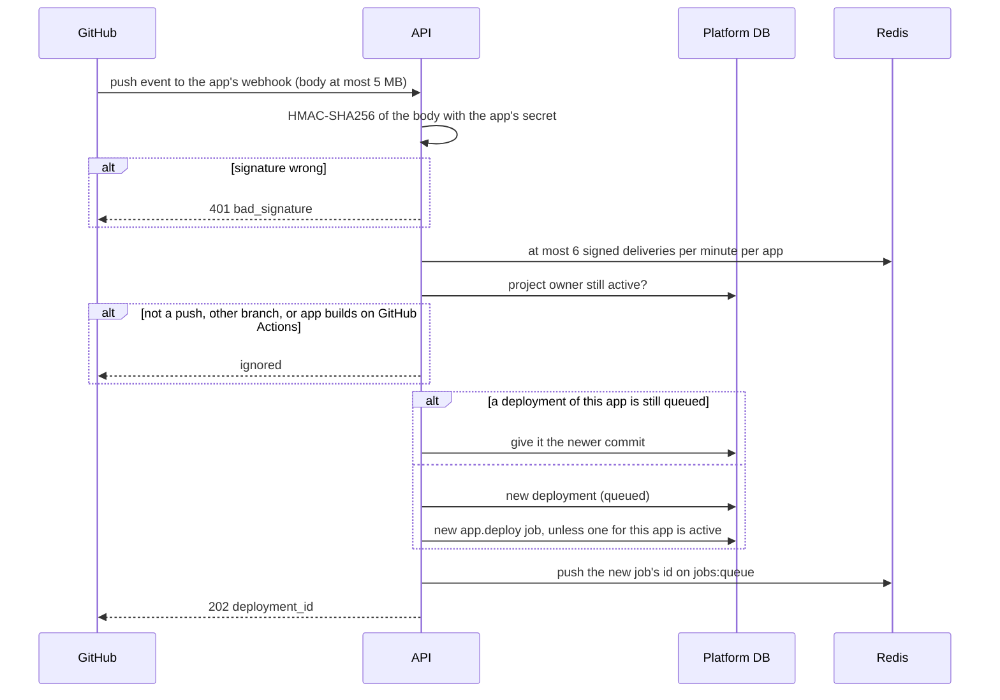

From `api/app/routers/apps.py` (`github_webhook`, `_github_delivery`) and
`api/app/services/deployments.py` (`verify_signature`, `handle_push`, `start_deployment`).

GitHub signs every delivery with a secret only it and Deployer know; anything else is turned away
before it can use up the app's delivery limit. Only one deploy per app runs at a time: a push that
arrives while another deploy is waiting simply updates the waiting one to the newest commit.

### The worker's deploy job

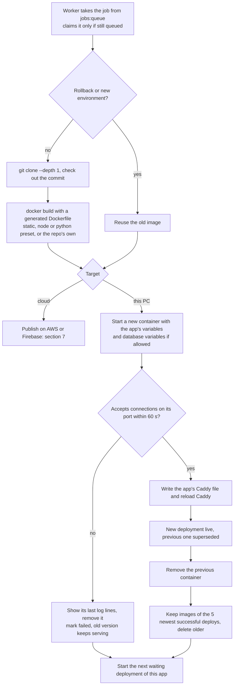

From `api/app/services/deployments.py` (`_job_deploy`, `generate_dockerfile`, `build_image`,
`route_app`, `render_caddyfile`, `_prune_images`, `rollback`), `api/app/services/jobs.py` (`claim`) and
`api/app/worker.py` (`runner_loop`).

The new version is started next to the old one and only gets traffic once it answers on its port; then
Caddy's per-app file (`caddy_apps/<app id>.caddy`) is pointed at it, so visitors switch over without a
gap. A failed build or health check leaves the previous version serving. The images of the last five
successful deploys are kept, which is what "Rollback" re-uses: a rollback is a new deployment that
skips the clone and build. Tokens and secret variables are removed from the build log before it is saved.

### Crash recovery

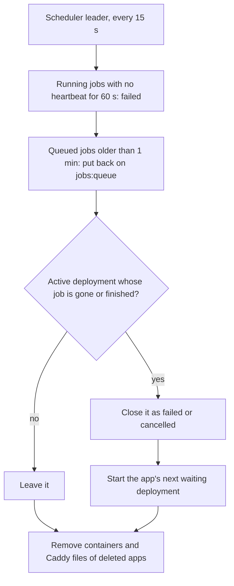

From `api/app/worker.py` (`scheduler_tick`, `main`), `api/app/services/jobs.py` (`recover_stale`,
`redispatch_queued`) and `api/app/services/deployments.py` (`scheduler_tick`, `_sweep_queued`,
`_remove_orphans`).

A running job refreshes a "still alive" key in Redis every 15 seconds. If the worker crashes or the
PC restarts mid-deploy, that key expires, the job is marked failed and its deployment is closed, so
the app is not stuck "building" forever and its next deploy can start. The worker also does this check
once when it starts.

## 5. Backups and point-in-time recovery

### What the scheduler starts

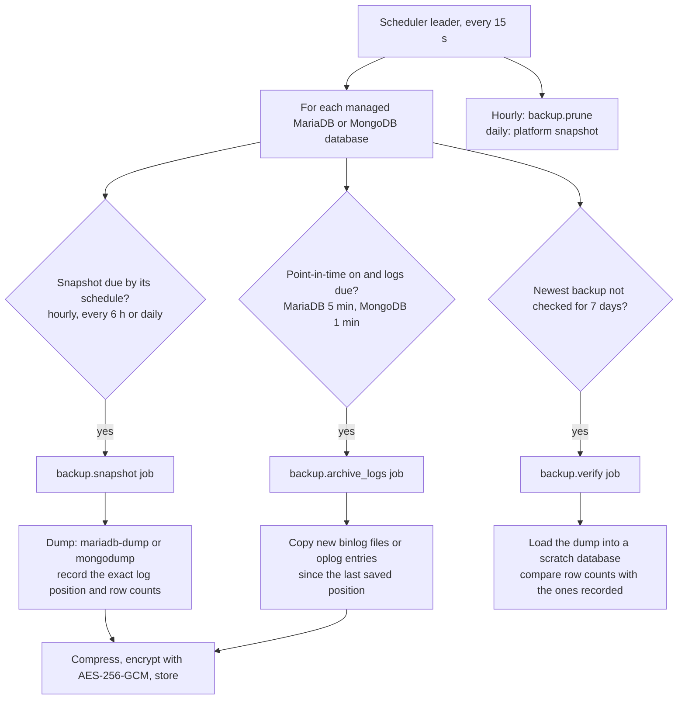

From `api/app/services/backups.py` (`scheduler_tick`, `start_snapshot`, `perform_snapshot`,
`archive_source_logs`, `perform_verify`), `api/app/services/backup_engine.py` and
`api/app/services/backup_crypto.py`.

A snapshot is a full copy of one database, taken at a known spot in the database's change log. Between
snapshots, the change log itself (MariaDB's binlog, MongoDB's oplog) is copied every few minutes, so any
moment can be rebuilt later. Everything is encrypted with a key derived from the install's
`MASTER_KEY`. Once a week the newest backup is test-restored into a scratch database and its row counts
compared, so a broken backup is found before you need it.

### Restoring

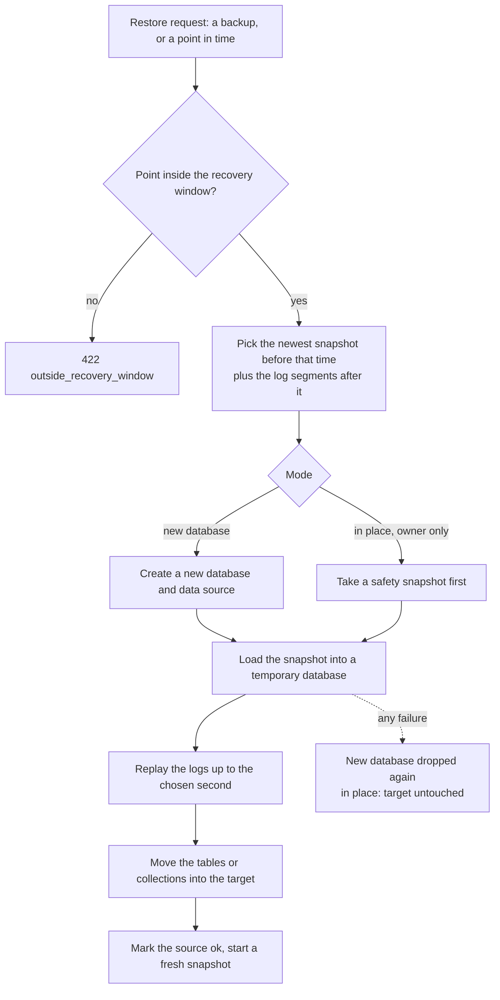

From `api/app/services/backups.py` (`recovery_window`, `plan_restore`, `start_restore`,
`perform_restore`, `_discard_new_source`) and `api/app/services/backup_engine.py`.

The usual restore makes a new database next to the old one, so nothing you have is overwritten. An
in-place restore is for owners only and always takes a safety snapshot first. Either way the data is
rebuilt in a temporary database and only moved into place once that worked.

## 6. A co-hosting sync round

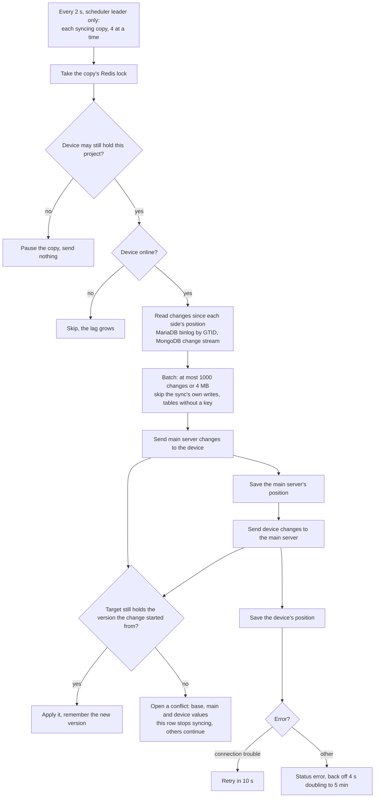

From `api/app/services/source_sync.py` (`sync_loop`, `run_due`, `_run_one`, `sync_round`, `_Round`,
`apply_changes`, `read_sql_changes`) and `api/app/services/cohosting.py` (`cohost_problem`).

A co-host device keeps a live copy of a main-server database, and changes made on either side are
copied to the other every two seconds. A change is applied only if the other side still has the value
it started from; if both sides changed the same row, that row becomes a conflict and waits for a person,
while every other row keeps syncing. Writes made by the sync are marked (MariaDB `server_id`, or a
`sql_log_bin = 0` session on the device; for MongoDB a stored version hash) so they are not copied back
again in an endless loop. If the device's owner loses the right to hold the project, the copy is paused
and gets nothing more.

### Resolving a conflict

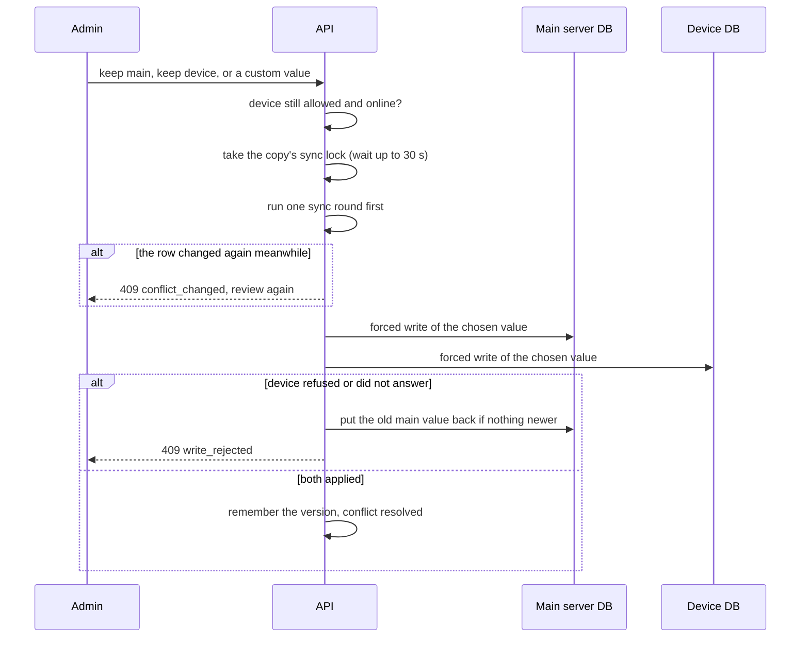

From `api/app/services/cohosting.py` (`resolve`, `write_both`, `_undo_primary`, `_drain`).

The chosen value is written to the main server first and then the device, while the regular sync is
held off by the same lock. If the device does not take it, the main server's change is undone, so the
two copies never silently disagree; when that cannot be guaranteed a new conflict is opened instead.

## 7. Deploying to the cloud

### Choosing a target and publishing

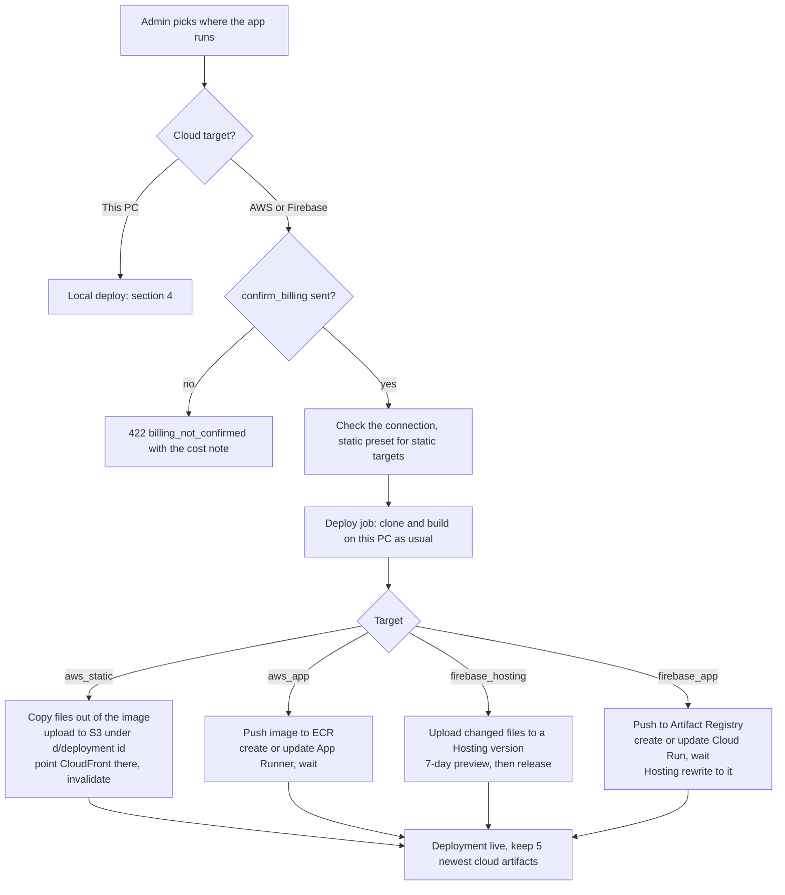

From `api/app/routers/apps.py` (`_check_target`, `_check_billing`, `_switch_target`), `api/app/services/cloud.py` (`TARGETS`) and `api/app/services/cloud_deploy.py`
(`go_live`, `Publish.aws_static`, `aws_app`, `firebase_hosting`, `firebase_app`, `prune`).

Running an app on AWS or Firebase costs money on your own cloud account, so the API refuses until the
request says the charges are accepted (the dashboard shows the cost first). The app is still built on
this PC; only the finished files or image are sent to the cloud. Each cloud resource's id is saved the
moment it is created, so a retry never makes a second one and deleting the app knows what to remove.
Cloud apps get no address pointing back at this PC, because they must keep working while it is off.

### Building on GitHub Actions instead

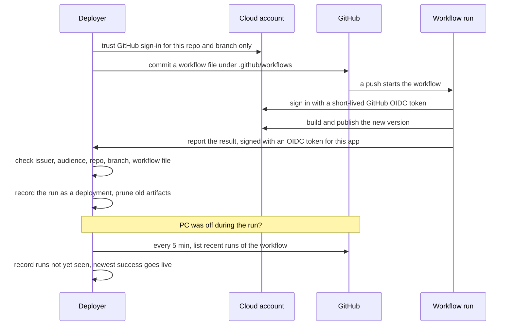

From `api/app/services/github_actions.py` (`_setup`, `render_workflow`, `record_report`, `_verify`,
`reconcile`, `_reconcile_app`) and `api/app/routers/apps.py` (`_actions_report`).

With this option GitHub's computers build every push, so the app deploys even when the PC is off.
No cloud key is stored in the repository: the workflow proves who it is with a token GitHub issues
for that one run, which the cloud account has been told to trust for that repository and branch only.
When the PC comes back it asks GitHub for the runs it missed and adds them to the history, so rollback
still works.

## 8. Installing, updating and staying up

### `deployer update`

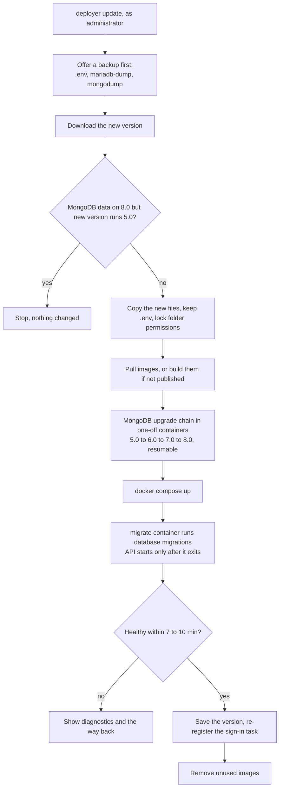

From `installer/deployer.ps1` (`Invoke-Update`, `Invoke-Backup`), `installer/lib/common.ps1`
(`Assert-DeployerMongoRef`, `Invoke-DeployerImages`, `Update-DeployerMongo`, `Wait-DeployerHealth`),
`deploy/docker-compose.yml` (`migrate`) and `api/docker-entrypoint.sh`.

An update replaces the program files but never `.env`, which holds the install's keys and passwords.
MongoDB can only open data from its own or the previous major version, so older data is upgraded one
version at a time before the new MongoDB starts; an interrupted upgrade continues where it stopped.
Database changes are applied by a one-shot `migrate` container before the API starts, so a slow
migration on an old PC cannot make the API look broken. If the update fails, the message names the
backup and the version to go back to.

### The sign-in task and keep-alive

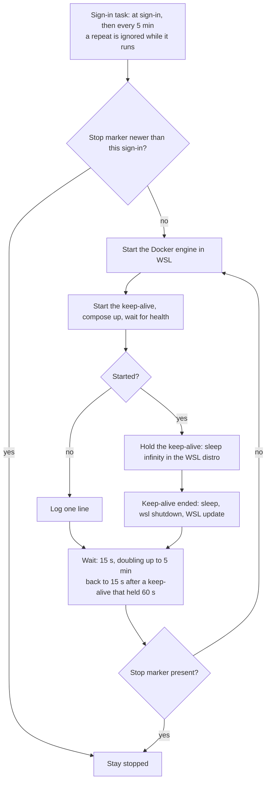

From `installer/deployer.ps1` (`Invoke-Start`, `Start-Stack`, `Invoke-Stop`) and
`installer/lib/common.ps1` (`Register-DeployerTask`, `Invoke-DeployerKeepAliveLoop`,
`Start-DeployerKeepAlive`, `Get-DeployerSignInTime`).

Windows shuts down an idle WSL distro, which would take the whole site with it, so a tiny process that
sleeps forever is kept running inside it. The sign-in task watches that process: whenever it ends
(sleep, hibernate, WSL updating itself) the stack is started again, with growing pauses while WSL is
unavailable (this loop is for the default WSL engine; with Docker Desktop the task only starts the
stack once). `deployer stop` writes a stop marker first, which is the only way out of this loop; the
task also re-runs every five minutes as a watchdog in case the loop itself died, but respects a stop
made during the current sign-in.
