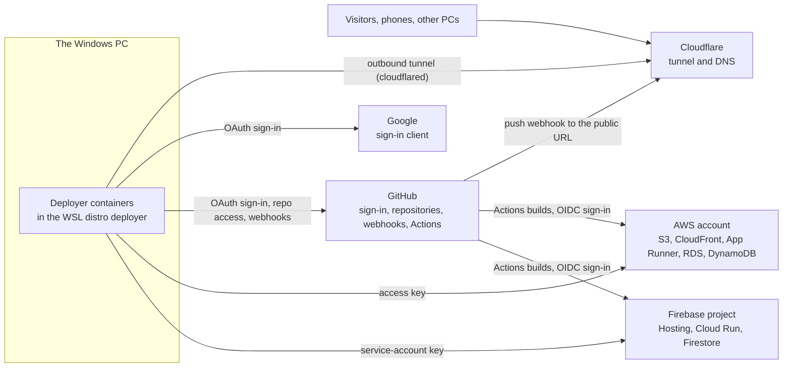
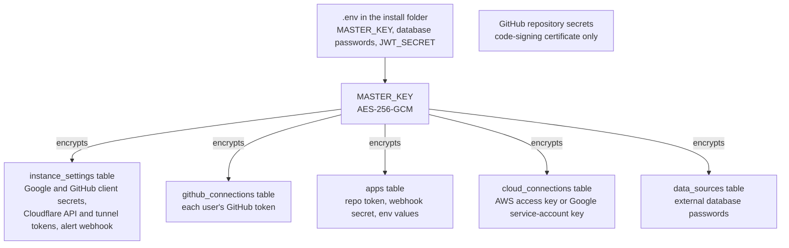
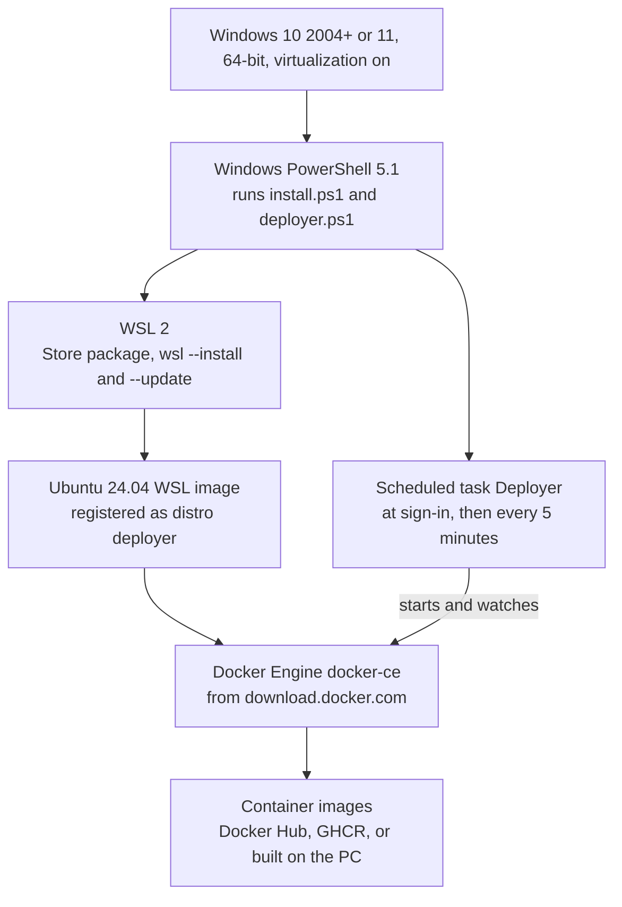
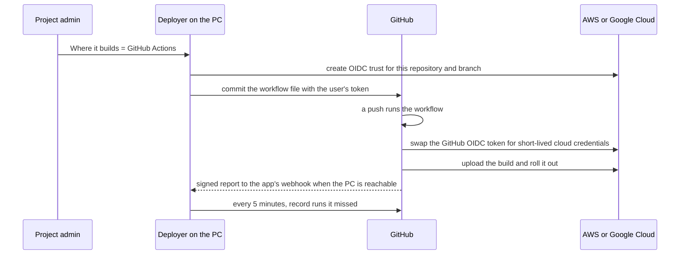

# Platforms and accounts this project uses

Every outside platform, service or tool that Deployer needs or can use: what it is for, whether it is
required (and for whom), where its console is, what to create there, where Deployer keeps the result,
and what it costs. Three kinds of reader:

- **Running an install**: someone who installs Deployer on their own PC. Only the computer (a Windows PC, or a Linux server) is required;
  everything else is optional and uses *their own* accounts (Deployer ships with no keys, apps or
  accounts from its authors: [ARCHITECTURE.md](ARCHITECTURE.md) "Guiding rules").
- **Developing**: someone changing the code in this repository ("For developers" at the end).
- **The owner's live instance**: <https://deployer.liewjiaen.com>, summarised in
  "The owner's live instance" below (no secrets, IDs or tokens in this page).

## At a glance

| Platform | Used for | Required? |
|---|---|---|
| [Windows PC](#the-windows-pc) (Windows 10 2004+ / 11, WSL 2, Docker Engine, PowerShell 5.1) | Runs everything | **Required** for every install, unless it runs on a Linux server |
| [Linux server](#a-linux-server-instead-of-the-windows-pc) (x86_64, systemd, Docker Engine + Compose 2.20+) | Runs everything instead of a Windows PC, headless included | Optional alternative |
| [GitHub](#github) | Source code, CI and releases; optional sign-in; push-to-deploy; cloud builds | Required for developing; optional for an install |
| [Cloudflare](#cloudflare) | Reaching Deployer and its apps from the internet on your own domain | Optional (quick tunnel needs no account) |
| [Google Cloud: sign-in client](#google-cloud-sign-in-with-google) | "Sign in with Google" | Optional |
| [Firebase / Google Cloud project](#firebase--google-cloud-hosting-and-databases) | Apps and databases that keep running when the PC is off | Optional, billed to you |
| [AWS](#aws) | Apps and databases that keep running when the PC is off | Optional, billed to you |
| [Others](#other-optional-services) | External databases (MongoDB Atlas, MySQL, PostgreSQL), alert webhooks, Tailscale, Docker Desktop, a code-signing certificate, AI agents | Optional |

From `api/app/services/oauth.py`, `services/github.py`, `services/cloudflare.py`, `services/remote_access.py`,
`services/cloud.py` and `services/github_actions.py`.

Everything runs on the PC; the other platforms are add-ons it talks to. Visitors never reach the PC
directly: they reach Cloudflare, and the PC keeps an outgoing connection open to Cloudflare that their
requests travel back through. AWS and Firebase are where apps and databases can live instead of the PC,
so they keep working when it is switched off; GitHub can build and push to them without the PC.

### Where the keys end up

From `api/app/services/instance_settings.py` (`SECRET_KEYS`), `api/app/models.py`, `api/app/crypto.py` and
`.github/workflows/release.yml`.

Almost every key you paste into Deployer is stored in its own database (MariaDB), scrambled with one
master key that lives only in the `.env` file on the PC. Without that `.env` file the stored keys
cannot be read back, which is why the README says to keep a copy of it. The only secrets kept on
GitHub are for signing the installer, and only if you choose to sign it.

## The Windows PC

**Required for every install.** It runs the whole stack.

| Item | What Deployer needs | Checked by |
|---|---|---|
| Windows | 64-bit Windows 10 version 2004 (build 19041) or newer, or Windows 11 (Home is fine) | `installer/install.ps1` preflight: older builds fail |
| CPU | Intel or AMD 64-bit; ARM64 is refused (the images are amd64 only). Hardware virtualization (Intel VT-x / AMD SVM) on in the BIOS/UEFI | preflight warns when it looks off |
| AVX | Managed MongoDB 8.0 needs AVX (most CPUs since about 2011). Without it the installer turns managed MongoDB off; use an external MongoDB instead | `Test-DeployerCpuAvx` in `installer/lib/common.ps1` |
| Memory | 4 GB minimum, 8 GB recommended. WSL 2 gives Deployer about half the RAM | preflight warns |
| Disk | 10 GB free | preflight warns |
| Administrator rights | To turn on WSL, register the sign-in task and (optionally) the firewall rule and LAN port forward | the installer asks once |

**WSL 2 and the Microsoft Store WSL package.** The installer runs `wsl --install --no-distribution`
(may need a restart; setup resumes after sign-in), then `wsl --update` (falling back to
`--web-download`). That installs WSL from the Microsoft Store package "Windows Subsystem for Linux",
which updates itself; while Windows services it, `wsl.exe` cannot start (the 2026-10-05/06 outage in
[HANDOVER.md](HANDOVER.md)), and the sign-in task keeps retrying until it can. Manual install if that
fails: <https://aka.ms/wslinstall>. Deployer uses WSL's default NAT networking; the installer warns
about `networkingMode=mirrored` in `.wslconfig`.

**Docker Engine inside the `deployer` distro (default runtime).** No Docker account and no Docker
Desktop: the installer downloads the official Ubuntu 24.04 WSL image (checksum-checked against
`releases.ubuntu.com` or `cloud-images.ubuntu.com`), registers it as the distro `deployer` with its disk
under `C:\ProgramData\Deployer\wsl`, and installs `docker-ce` from Docker's apt repository
(`download.docker.com`) inside it (`installer/wsl/setup-engine.sh`). Free (Apache-2.0).

**Container images.** Pulled anonymously: `mariadb:11`, `mongo:8.0` (plus `mongo:6.0` / `7.0` for the
one-off upgrade steps), `redis:7-alpine` and `caddy:2-alpine` from Docker Hub; Deployer's own `api`,
`dashboard` and `tunnel` images from GHCR (`ghcr.io/<owner>/deployer-*`) once a release exists. Until
then, or with `-FromSource`, the PC builds them from the repository, which also downloads the base
images (`python:3.12-slim-bookworm`, `node:22-alpine`, `nginx:1.27-alpine`, `alpine:3.24`), the
`cloudflared` binary from Cloudflare's GitHub releases, and MongoDB / MariaDB client tools.

From `installer/install.ps1` (`Invoke-Preflight`, `Initialize-WslPlatform`, `Get-UbuntuWslImage`),
`installer/wsl/setup-engine.sh`, `installer/lib/common.ps1` and `deploy/docker-compose.yml`.

Windows provides a small built-in Linux machine (WSL); Deployer installs its own copy of Ubuntu into it
and runs Docker there, so nothing else on the PC changes. Docker then runs each part of Deployer (the
API, the databases, the web server) as a separate "container". A scheduled task starts all of it when
the installing account signs in and checks every 5 minutes that it is still running.

**PowerShell 5.1.** `install.ps1`, `deployer.ps1` and the sign-in task run in Windows PowerShell 5.1
(`powershell.exe`, built into Windows), not PowerShell 7. Each call passes `-ExecutionPolicy Bypass`, so
the PC's execution policy is not changed. Scripts must stay ASCII-only (CI checks this), because 5.1
reads files without a byte-order mark as ANSI.

**DeployerSetup.exe / Deployer Control** is a WinForms app for .NET Framework 4.8, which Windows 10
2004+ and 11 already include.

**Where Deployer keeps its state:** `C:\ProgramData\Deployer` (`.env` with `MASTER_KEY`, `runtime.json`,
`logs\`, `backups\`, `wsl\`). **Cost:** free; your electricity and internet.

**Other PCs (optional).** Host devices ([DEVICES.md](DEVICES.md)) and co-host PCs
([COHOSTING.md](COHOSTING.md)) are more computers running Deployer (Windows PCs, or Linux servers as
below), with the same requirements. They connect outbound to the main Deployer's public URL.

## A Linux server (instead of the Windows PC)

**Optional alternative to the Windows PC**, headless servers included. Same containers, same
`docker-compose.yml`; only the installer and the `deployer` command differ (`installer/install.sh`,
`installer/deployer.sh`). Walkthrough: [SETUP.md](SETUP.md).

| Item | What Deployer needs | Checked by |
|---|---|---|
| Linux | Any distribution with systemd (for start at boot; without it Docker's restart policy still brings the containers back when Docker starts) | `deployer.sh install` |
| CPU | x86_64 only (the images are amd64); AVX for managed MongoDB 8.0, as on Windows | `deployer.sh install` refuses other architectures, turns MongoDB off without AVX |
| Kernel | For managed MongoDB 8: not 6.19 to 7.0.13, which MongoDB refuses ([SERVER-121912](https://jira.mongodb.org/browse/SERVER-121912); Ubuntu 26.04's 7.0 kernel, GitHub's `ubuntu-24.04` runners since 2026-10-18) | `deployer.sh install` / `update` run `mongod --version` in the real image and turn MongoDB off with MongoDB's reason; CI runs the MongoDB jobs on `ubuntu-22.04` |
| Docker | Docker Engine with the Compose v2 plugin, 2.20 or newer (`depends_on.required`), and buildx for local builds. On Debian, Ubuntu and Ubuntu-based distributions the installer adds Docker's apt repository (`download.docker.com`) and installs `docker-ce` with `installer/wsl/setup-engine.sh --host` (asks first; never upgrades the server's other packages) | `deployer.sh install` |
| Memory / disk | 4 GB RAM (8 GB recommended; no WSL halving), 10 GB free under `/var/lib` | warns |
| Ports | 8080 (or `--port`) and 8100-8199 free; bound to `127.0.0.1` until `deployer lan on [ip]` | `ss` in `deployer.sh install` |
| Root | `sudo`: Docker's socket and `.env` are root-only | the CLI re-runs itself with sudo |

**Reaching a headless server:** an SSH tunnel (`ssh -L 8080:localhost:8080 you@server`) for the setup
wizard; for everyone else the Cloudflare tunnel below (no open ports), or `deployer lan on` (Docker
publishes ports past ufw/firewalld, so on a public IP prefer the tunnel or `lan on <LAN IP>`).

**Where Deployer keeps its state:** `/opt/deployer` (`.env` with `MASTER_KEY`, `DEPLOYER_REPO` /
`DEPLOYER_REF` in it instead of `runtime.json`, `logs/`, `backups/`), Docker volumes under
`/var/lib/docker`, `/etc/systemd/system/deployer.service`, `/usr/local/bin/deployer`. **Cost:** free.

## GitHub

### The repository, CI and releases

**For developing and for publishing releases.** An install only reads from it (it downloads
`install.ps1`, the source zip or the release's `deployer-deploy.zip`, and asks the GitHub API for the
latest release); no GitHub account is needed for that.

- **Where:** <https://github.com/nyx-ulrix/deployer> (public; default branch `main`). A fork works the same:
  installers take `-Repo owner/name`.
- **Workflows** (`.github/workflows/`):

| Workflow | Runs on | Secrets it uses | Permissions |
|---|---|---|---|
| `ci.yml` | every push to `main`, pull requests, and called by the release | none (a random MariaDB / MongoDB password per run) | `contents: read` |
| `secret-scan.yml` | every push and pull request; gitleaks `v8.28.0` with `.gitleaks.toml` | none | `contents: read` |
| `release.yml` | `v*` tags only, after the whole CI suite passes | `GITHUB_TOKEN` (automatic), optional `WINDOWS_SIGNING_PFX` and `WINDOWS_SIGNING_PASSWORD` | `packages: write` for the image job, `contents: write` for the release job, read elsewhere |

- **What a release makes:** `ghcr.io/<owner>/deployer-api`, `deployer-dashboard` and `deployer-tunnel`
  (tagged with the version and, except for pre-releases, `latest`), and a GitHub release with
  `DeployerSetup.exe`, `deployer-deploy.zip` and their `.sha256` files.
- **GHCR (GitHub Container Registry):** installs pull the images without signing in, so the three
  packages must be **public**. `v0.1.0`'s came out public (they are linked to the public repository; an
  anonymous pull of `deployer-api:0.1.0` answers 200). A fork whose packages are private: open each one on
  the owner's GitHub profile (*Packages* -> the package -> *Package settings* -> *Change visibility*).
  While they cannot be pulled, the installer builds the images on the PC.
- **Cost:** free for a public repository (Actions minutes and public packages included).

### Sign in with GitHub (an OAuth app)

**Optional for an install.** Lets people sign in with GitHub, and is also the app behind "Connect
GitHub" below.

- **Where:** <https://github.com/settings/developers> -> *OAuth Apps* -> *New OAuth App* (an OAuth App,
  not a GitHub App). The dashboard's guided setup opens this form pre-filled.
- **Create:** Homepage URL `<PUBLIC_URL>`; Authorization callback URL
  `<PUBLIC_URL>/v1/auth/oauth/github/callback`; then *Generate a new client secret*. Deployer checks the
  client ID looks like one (`Ov23...`, `Iv23...` or 20 alphanumerics) and only refuses a secret that looks
  like a client ID (`instance_settings.validate_oauth_value`).
- **Scopes it asks for at sign-in:** `read:user user:email` (`oauth.PROVIDERS`).
- **Where Deployer keeps it:** the `instance_settings` table in MariaDB (`github_client_id` in plain
  text, `github_client_secret` encrypted with `MASTER_KEY`). Set it in the setup wizard, *Instance
  settings*, Deployer Control's *Sign-in apps* page or `deployer oauth set github`. `GITHUB_CLIENT_ID` /
  `GITHUB_CLIENT_SECRET` in `.env` are only a fallback used while nothing is stored in the database.
- **When the public URL changes** (a tunnel, a new domain, a new port on `localhost`), update the
  callback URL or sign-in fails with `redirect_uri_mismatch`.
- **Cost:** free.

### Connect GitHub (push-to-deploy) and webhooks

**Optional**, per user. Lets a user pick their repositories (private ones included) for an app and
lets Deployer add the push webhook itself ([DEPLOYMENTS.md](DEPLOYMENTS.md)).

- **Needs:** the GitHub sign-in app above; nothing else to register.
- **Scopes:** `repo admin:repo_hook read:user workflow` (`github.CONNECT_SCOPE`). `workflow` is needed only
  for GitHub Actions builds (below); connections made before it existed must connect again.
- **Where Deployer keeps it:** the `github_connections` table, one row per user, token encrypted with
  `MASTER_KEY`. Disconnect under *Settings -> Account*; also revocable at
  <https://github.com/settings/applications>.
- **Webhooks:** Deployer creates a `push` webhook on the repository pointing at the app's webhook URL
  on `<PUBLIC_URL>`, with a per-app secret (stored encrypted in the `apps` table) that GitHub signs every
  delivery with. GitHub cannot reach `localhost` or a LAN address, so push-to-deploy needs a public URL
  (Cloudflare, below).
- **Without the connection:** paste the repository URL, and for a private repository a fine-grained
  personal access token (<https://github.com/settings/personal-access-tokens/new>) with
  **Contents: read** on that repository (stored encrypted in the `apps` table); add the webhook by hand
  from the app's *Settings* (content type `application/json`, just the push event).
- **Cost:** free.

### GitHub Actions builds with OIDC (cloud apps)

**Optional**, per cloud app ("Where it builds" -> GitHub Actions, [CLOUD.md](CLOUD.md) "C3 as built").
GitHub builds every push on its own runners and deploys straight to AWS or Firebase, so pushes deploy
while the PC is off.

- **Needs:** an app on an AWS or Firebase target that was deployed once from the PC; a
  `https://github.com/<owner>/<repo>` repository the admin can push to; the admin's GitHub connection
  with the `workflow` scope; the cloud permissions marked "GitHub Actions" in the AWS and Google sections
  below.
- **What Deployer creates:** a workflow file `.github/workflows/deployer-<slug>-<id8>.yml` committed to
  the app's branch (with `permissions: contents: read, id-token: write`); on AWS, the account's OIDC
  identity provider for `token.actions.githubusercontent.com` and a role `deployer-gha-<slug>-<id8>`
  that only that repository's branch may assume; on Google, the workload identity pool `deployer-github`
  and a provider `gh-<id8>` limited to that repository and branch.
- **No secrets in GitHub:** the workflow signs in with a short-lived GitHub OIDC token; no AWS or
  Google key is stored in the repository.
- **Cost:** free for public repositories; private ones use the account's included minutes (2,000 a month
  on GitHub Free), then GitHub bills. The IAM role, identity provider and pool are free.

From `api/app/services/github_actions.py` (`render_workflow`, `reconcile`), `services/cloud_aws.py`,
`services/cloud_gcp.py` and `services/github.py`.

Deployer sets things up once: it tells the cloud account to trust builds from one repository and
branch, and adds a build recipe file to that repository. After that, GitHub builds each push and
proves who it is to the cloud with a short-lived pass instead of a stored password. When the PC is on
again, Deployer catches up on the builds that happened while it was off.

## Cloudflare

**Optional.** Gives Deployer and its apps stable `https://` addresses on your own domain, with no
router port forwarding and no certificates to manage ([REMOTE_ACCESS.md](REMOTE_ACCESS.md)). In
practice it is also what gives push-to-deploy webhooks, GitHub Actions reports, and host devices or
co-host PCs outside your network the public URL they need.

- **Where:** <https://dash.cloudflare.com>. A free account.
- **Domain / DNS zone:** add a domain you own to the account as a zone (Cloudflare becomes its DNS; at
  your registrar, change the nameservers to the two Cloudflare shows). Deployer only adds hostnames
  inside a zone of the linked account.
- **API token:** <https://dash.cloudflare.com/profile/api-tokens> -> *Create Custom Token* with exactly
  these four permissions (`cloudflare.PERM_*`); Account resources: the account that owns the domain; Zone
  resources: that zone (or all zones):

| Scope | Permission |
|---|---|
| Account -> Cloudflare Tunnel | Edit |
| Account -> Account Settings | Read |
| Zone -> DNS | Edit |
| Zone -> Zone | Read |

- **What Deployer creates with it:** a remotely-managed tunnel `deployer-<first 8 of instance_id>`
  (and `deployer-apps-<...>` for co-hosted apps), proxied CNAME records `<hostname>` -> the tunnel, and
  for cloud apps' custom domains the DNS records AWS / Firebase ask for. The `tunnel` container
  (`cloudflared`) connects outbound over HTTPS port 443 (`TUNNEL_PROTOCOL=http2` in `.env`).
- **Where Deployer keeps it:** `instance_settings` (`cloudflare_api_token` and the tunnel's connector
  token encrypted; account and tunnel IDs in plain text). Link, replace or unlink under *Settings ->
  Domains & remote access*. Never asks for the Cloudflare password.
- **Quick tunnel (no account):** a random `https://<words>.trycloudflare.com` address that changes
  whenever the tunnel restarts. Good for testing; not for sign-in apps or host devices.
- **Cost:** the Cloudflare plan and tunnels are free; the domain itself costs its yearly registration fee
  at your registrar.

## Google Cloud: sign in with Google

**Optional for an install.** Lets people sign in with a Google account. Separate from the Firebase
project below (it can be the same Google Cloud project, but does not need to be).

- **Where:** <https://console.cloud.google.com> -> create or pick a project -> *Google Auth Platform*.
- **Create:** *Branding* (app name, support and developer emails); *Audience*: **External** (in
  *Testing* only listed test users can sign in; *Publish app* lets any Google account in, with no
  Google review needed for these scopes); *Clients -> Create client -> Web application* with the
  authorized redirect URI `<PUBLIC_URL>/v1/auth/oauth/google/callback`. Copy the secret at once.
- **Scopes:** `openid email profile` (`oauth.PROVIDERS`). Google has no API to create web OAuth clients, so
  this stays a guided manual setup.
- **Where Deployer keeps it:** `instance_settings` (`google_client_id`, which must look like
  `1234-abc.apps.googleusercontent.com`; `google_client_secret` encrypted). Same places to set it as
  GitHub's, and the same `.env` fallback (`GOOGLE_CLIENT_ID` / `GOOGLE_CLIENT_SECRET`).
- **Cost:** free.

## Firebase / Google Cloud: hosting and databases

**Optional, billed to you.** Puts apps and databases in your own Firebase project so they keep running
when the PC is off ([CLOUD.md](CLOUD.md)). Instance owner only, under *Settings -> Cloud accounts*.

- **Where:** <https://console.firebase.google.com> (the project) and <https://console.cloud.google.com>
  (APIs, service accounts, IAM).
- **Plan:** static sites work on the free Spark plan; full apps (Cloud Run) need **Blaze**
  (pay-as-you-go). A budget alert in Cloud Billing is a good idea.
- **Service account:** *IAM & Admin -> Service accounts -> Create*, name it `deployer`, grant the roles
  below, then *Keys -> Add key -> Create new key -> JSON* and paste the whole file into Deployer. Delete
  the download afterwards.

Roles (`cloud.GOOGLE_ROLES`; the first five always, the rest only for the feature named):

| Role | Needed for |
|---|---|
| `roles/firebasehosting.admin` (Firebase Hosting Admin) | sites, versions, releases |
| `roles/firebase.viewer` (Firebase Viewer) | checking the project when the key is saved |
| `roles/run.admin` (Cloud Run Admin) | deploying full apps and making them public |
| `roles/artifactregistry.admin` (Artifact Registry Administrator) | the apps' image repository |
| `roles/iam.serviceAccountUser` (Service Account User) | running the app as its identity |
| `roles/datastore.user` (Cloud Datastore User) | Firestore databases: read and write documents |
| `roles/datastore.importExportAdmin` | Firestore exports to Cloud Storage and imports |
| `roles/datastore.owner` (Cloud Datastore Owner) | creating Firestore databases, scheduled backups, restores |
| `roles/storage.admin` (Storage Admin) | Firestore exports: on the bucket you made, or on the project so Deployer can make a `deployer-*-firestore` bucket |
| `roles/firebasedatabase.admin` (Firebase Realtime Database Admin) | Realtime Databases |
| `roles/secretmanager.admin` (Secret Manager Admin) | apps that keep their variables in Secret Manager |
| `roles/iam.workloadIdentityPoolAdmin` | GitHub Actions builds (one pool, one provider per app) |
| `roles/iam.serviceAccountAdmin` | GitHub Actions builds; grant it **on the `deployer` service account itself**, not the project |

APIs to enable (`cloud.GOOGLE_APIS`): always `firebasehosting.googleapis.com` and
`firebase.googleapis.com`; for full apps `run.googleapis.com` and `artifactregistry.googleapis.com`; for
Firestore `firestore.googleapis.com`; for Firestore backups `storage.googleapis.com`; for Realtime
Databases `firebasedatabase.googleapis.com`; for Secret Manager `secretmanager.googleapis.com`; for
GitHub Actions builds `iam.googleapis.com`, `sts.googleapis.com` and `iamcredentials.googleapis.com`.

Full apps that use a Firestore or Realtime Database run as the project's default compute service
account (`PROJECT_NUMBER-compute@developer.gserviceaccount.com`): grant it Cloud Datastore User (and
Firebase Realtime Database Admin for a Realtime Database) unless it already has Editor.

- **Region:** default `us-central1`, changeable per connection.
- **Where Deployer keeps it:** the `cloud_connections` table (the key file's `type`, `project_id`,
  `private_key_id`, `private_key` and `client_email`, plus project and region, encrypted with
  `MASTER_KEY`), instance-wide or for one project. Never shown again; removable any time.
- **Cost (billed by Google):** Hosting is free within Spark's 10 GB storage and 360 MB/day; Cloud Run
  per request and CPU time (near zero when idle) plus Artifact Registry storage; Firestore beyond the
  free daily quota about US$0.06 per 100,000 reads and US$0.18 per 100,000 writes; Realtime Database
  beyond the free tier about US$5 per GB stored and US$1 per GB downloaded a month; Secret Manager 6
  free versions a month, then about US$0.06 per version.

## AWS

**Optional, billed to you.** Static sites on S3 + CloudFront, full apps on App Runner, SQL databases on
RDS / Aurora and NoSQL tables on DynamoDB, all in your own account ([CLOUD.md](CLOUD.md)). Instance
owner only, under *Settings -> Cloud accounts*.

- **Where:** <https://console.aws.amazon.com/iam/home>.
- **IAM user:** *Users -> Create user*, name it `deployer`, **no** console access.
- **Policies:** *Policies -> Create policy -> JSON*, once for each of the three documents the dashboard
  shows (`cloud.AWS_POLICIES`, read from the cloud requirements endpoint), then attach all three to the
  user. They are split because IAM caps one managed policy at 6,144 characters:

| Policy | Covers |
|---|---|
| `DeployerHosting` | S3, CloudFront, ACM certificates, ECR images, App Runner services, app secrets in Secrets Manager |
| `DeployerDatabases` | RDS / Aurora and their firewall (EC2 security groups and networking), DynamoDB tables, backups and restores, the optional NAT gateway |
| `DeployerRoles` | the `deployer-*` IAM roles for App Runner and GitHub Actions, always within `deployer-boundary`; the App Runner and RDS service-linked roles; the GitHub OIDC identity provider |

  The policies reach only resources named `deployer-*` (and firewall rules Deployer created), except
  DynamoDB item access on tables you connect. Every role Deployer creates must carry the permissions
  boundary **`deployer-boundary`**, which Deployer creates on save or first deploy and can never change or
  delete; you can create it yourself first from the JSON the dashboard shows. An account set up with an
  older version had one `DeployerHosting` policy: create and attach the other two first, then replace
  `DeployerHosting`'s JSON.
- **Access key:** the user's *Security credentials* -> *Create access key* -> *Application running
  outside AWS*. Deployer checks it looks like `AKIA...` / `ASIA...` with a 40-character secret, then calls
  STS `GetCallerIdentity`.
- **Optional role:** give the user only `sts:AssumeRole` on a role that has the three policies, and
  enter its ARN; Deployer assumes it for every call.
- **Region:** one per connection (for example `us-east-1` or `eu-west-1`): where buckets, images, App
  Runner services and databases are created. App Runner is not offered in every region or zone.
- **What Deployer creates there:** `deployer-*` S3 buckets, CloudFront distributions, ECR repositories,
  App Runner services, RDS instances, DynamoDB tables and secrets; the roles
  `deployer-apprunner-ecr-access`, `deployer-app-*` and `deployer-gha-*`; on request a shared NAT gateway.
- **Where Deployer keeps it:** the `cloud_connections` table (access key ID, secret, region, optional
  role ARN, account ID, encrypted with `MASTER_KEY`), instance-wide or for one project.
- **What AWS bills you for** (every billable action asks for confirmation first): S3 and CloudFront
  (mostly data out and requests; small sites often fit the free tier); App Runner about US$5+/month per
  idle app plus CPU time and ECR storage; RDS from about US$12/month (`db.t4g.micro`) plus storage, its
  public IPv4 address and backups; DynamoDB on demand (about US$0.63 per million writes, US$0.13 per
  million reads, US$0.25 per GB-month); Secrets Manager about US$0.40 per secret a month; the optional
  NAT gateway about US$32/month plus traffic. IAM, the boundary and the OIDC provider are free.

## Other optional services

| Service | Used for | Where Deployer keeps it | Cost |
|---|---|---|---|
| **MongoDB Atlas** (<https://www.mongodb.com/atlas>) | A NoSQL database when the PC has no AVX, or any external MongoDB. Create a cluster and a database user, and allow the PC's public IP in Atlas's network access list | the `data_sources` table, connection details encrypted | free M0 cluster; paid tiers billed by MongoDB |
| **Other external databases** (MySQL, MariaDB, PostgreSQL, MongoDB anywhere) | Attach an existing database to a project instead of a managed one; TLS supported | the `data_sources` table, encrypted | whatever the host charges |
| **Alert webhook** (Slack, Discord with `/slack` appended, ntfy, or your own `https://` endpoint) | Alerts for low disk, crash loops, failed backups, a down tunnel ([MONITORING.md](MONITORING.md)) | `instance_settings` `alert_webhook_url`, encrypted | usually free |
| **Tailscale** or another VPN | Not built into Deployer. Host devices can reach the main Deployer over it; plain `http://` is allowed for `*.ts.net` and private LAN addresses ([DEVICES.md](DEVICES.md)) | the device's link setting, encrypted | free personal plan |
| **Docker Desktop** | Alternative runtime (`-Runtime docker-desktop`, installed with `winget`). Free for personal use, education and small businesses (under 250 employees and US$10 million revenue); larger organisations need a paid Docker subscription | `runtime.json` | see Docker's terms |
| **Code-signing certificate** | Signs `DeployerSetup.exe` in `release.yml` (signtool, SHA-256, DigiCert timestamp) so SmartScreen does not warn | GitHub repository secrets `WINDOWS_SIGNING_PFX` (the `.pfx` file, base64) and `WINDOWS_SIGNING_PASSWORD` | a yearly fee to a certificate authority |
| **AI agents** (Claude Code or any MCP client) | The MCP server and the `deploy-website` skill ([MCP.md](MCP.md)) | a project API key in the agent's own config | the agent's own pricing |

## The owner's live instance

<https://deployer.liewjiaen.com>, on the owner's PC. Which of the above are set up (state as recorded in
[HANDOVER.md](HANDOVER.md)):

| Platform | Status |
|---|---|
| Windows PC | Set up: WSL engine runtime (distro `deployer`), LAN access and keep-awake on, sign-in task with the 5-minute watchdog |
| GitHub repository | `nyx-ulrix/deployer`, public; CI and secret scan run on every push |
| GitHub releases / GHCR | None yet (no tag): the PC builds its images; `DEPLOYER_VERSION=latest` |
| Code-signing secrets | Not set: `DeployerSetup.exe` would be published unsigned |
| Cloudflare | Zone `liewjiaen.com`, tunnel serving `deployer.liewjiaen.com` |
| Sign in with GitHub | Set up (OAuth app, stored in the database) |
| Connect GitHub (push-to-deploy) | Available through the same app; the flow is still to be tested end to end |
| Sign in with Google | Set up (OAuth client, stored in the database); still in Testing, so only listed test users can sign in |
| AWS | Not connected |
| Firebase / Google Cloud hosting | Not connected |
| GitHub Actions cloud builds | Not used (needs an AWS or Firebase connection) |

## For developers

What you need to work on this repository (see [CONTRIBUTING.md](../CONTRIBUTING.md) and the README's
"Development" section):

| Tool | Version | Used for |
|---|---|---|
| Git and a GitHub account | | clone, push, pull requests (write access to `nyx-ulrix/deployer` or a fork) |
| Python | 3.12 (CI uses 3.12) | `api/`: `python -m venv .venv`, then `pip install -r requirements.txt -r requirements-dev.txt` (pytest 9, fakeredis 2, ruff 0.16). On Windows the interpreter is `api\.venv\Scripts\python.exe` |
| Node.js and npm | Node 22 (CI uses 22) | `dashboard/`: `npm ci`, `npm run lint`, `npm run typecheck`, `npm run test -- --run`, `npm run build` |
| Docker with Compose v2 | | the full stack from source (`deploy/docker-compose.yml`, plus `docker-compose.dev.yml` for API hot reload) and the integration tests |
| MariaDB 11, MongoDB 8.0 | | `api/tests/integration` (skipped locally without them; CI runs them in containers and fails on any skip) |
| Windows PowerShell 5.1 and PSScriptAnalyzer | | installer checks: parse every script, `Invoke-ScriptAnalyzer -Severity Error`, the self-checking scripts in `installer/tests` |
| .NET Framework 4.8 C# compiler (`csc.exe`, part of Windows) | | `installer/windows/build.ps1` builds `DeployerSetup.exe`; no SDK needed |
| gitleaks (optional locally) | v8.28.0 in CI | secret scan; never commit real credentials, and build fake ones at runtime in tests |

CI runs on GitHub-hosted `ubuntu-latest` and `windows-latest` runners with `actions/checkout@v4`,
`actions/setup-python@v5`, `actions/setup-node@v4`, `docker/setup-buildx-action@v3`,
`docker/build-push-action@v6` and `actions/upload-artifact@v4`; releases add `docker/login-action@v3`,
`docker/metadata-action@v5`, `actions/download-artifact@v4` and `softprops/action-gh-release@v2`. Tests
never call real clouds: AWS is faked with `botocore.stub.Stubber`, Cloudflare and GitHub through
replaceable HTTP transports, so no cloud account is needed to develop.
